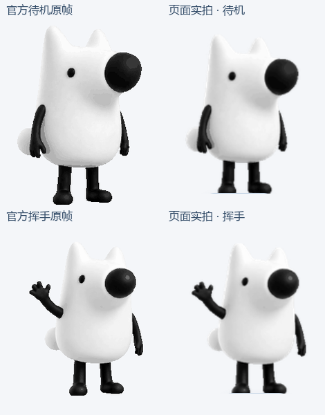

# 刘看山陪读桌宠

看山平时坐在书页外侧。它能看着读者的鼠标，也能被拿起来放到舒服的位置。需要找回刚才读到的那句时，点它就能接着读。

**形象来源**　桌宠使用知乎黑客松 S3 官方素材包里的「待机」「打招呼」「晃悠」透明动画。官方包还包含「瞌睡」「电脑」「运球」和三张角色参考图。平时按原片的侧身角度站立，保留白色头身、前伸的黑鼻子、小黑眼和黑色手脚。[赛事技术支持](https://hackathon-s3.event.zhihu.com/) · [下载官方素材包](https://zhstatic.zhihu.com/skill/application/beb7-261112/kanshan_material.zip)

| 读者的操作或状态 | 看山的回应 |
| --- | --- |
| 移动鼠标，或把鼠标停在一处 | 画面中能看见的小黑眼微微移向指针。鼠标停下后，看山继续看着那个位置。靠近原文页的看山，它会用官方动作招手。 |
| 按住看山，把它往任意方向拖 | 原文和书页都可以自由放置。看山随拖动方向倾斜，落下后轻轻回弹。两个页面分别记住位置。 |
| 在「设置刘看山」中换装 | 围巾和马甲是项目为官方角色绘制的服装，跟随站立、挥手和晃动。选「原样」可随时脱下。 |
| 鼠标在看山头上来回摸，或点面板里的「摸摸头」 | 看山朝一边蹭一下，再站稳。 |
| 在双页模式看书、前翻或后翻 | 看山双爪托住蓝皮书。读者翻页时，一只爪挑起纸角，纸面绕书脊弯过去，另一只爪接住落页。往回翻时两只爪交换动作。 |
| 点看山，选「接着这句读」 | 看山捧着蓝书，正文标出当前句。可以用跟读控件逐句前进。 |
| 开启「专注提醒」，在一屏停留超过预计时长两分钟 | 看山吹出「要接着这页读吗？」。翻页时气泡破开，看山轻跳一下。也可以收起气泡或继续读。 |

原文页轻点看山进入陪读，书页里轻点打开面板。键盘选中看山后，原文用方向键挪动，书页用 Alt 加方向键挪动。触屏可以用手指拖动，也可以从面板摸头。

专注提醒默认关闭，按本屏字数和每分钟 450 字估时。打开目录、打开陪读面板或切到后台会暂停计时，同一页提醒一次。安静模式和系统减少动态效果会收起挥爪、拖动摇摆和落地弹跳等动作。

## 动作设计参考

挥爪有起落，跳跃先蓄力。动作幅度按情境变化，读文章时让动作尽量小。[OpenAI 的 hatch-pet 动作说明](https://github.com/openai/skills/blob/main/skills/.curated/hatch-pet/scripts/prepare_pet_run.py)

放下看山时，先让脚着地、身体轻轻压低，再恢复站姿。这种先后顺序能表现出角色的重量。[迪士尼动画教学指南，第 12 页](https://a.dolimg.com/media/en-US/disneyeducationalproductions/noma/pdf/DE1775_NOMA_TG.pdf)

视线跟随是网页增加的交互。把原片中可见的眼睛单独分层，沿指针方向轻移。闭眼时沿用原片表情。[Rive 的鼠标跟随角色示例](https://rive.app/community/files/3920-8202-cat-following-the-mouse/) · [Emil Kowalski 的 animate 技能](https://github.com/emilkowalski/skills/blob/main/skills/animate/SKILL.md)

